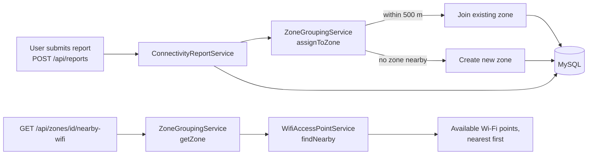
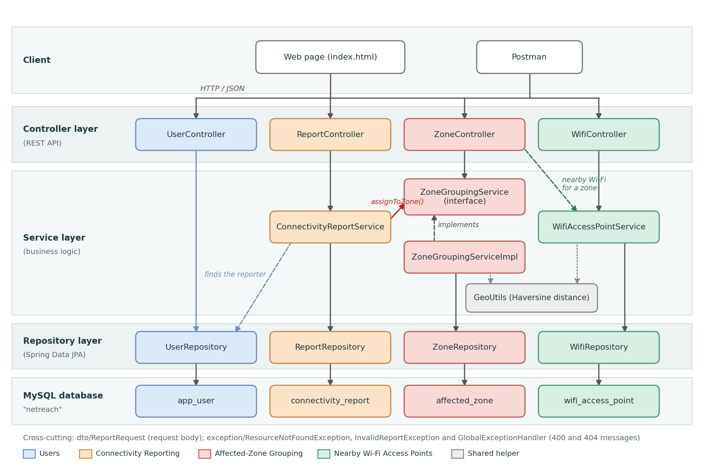
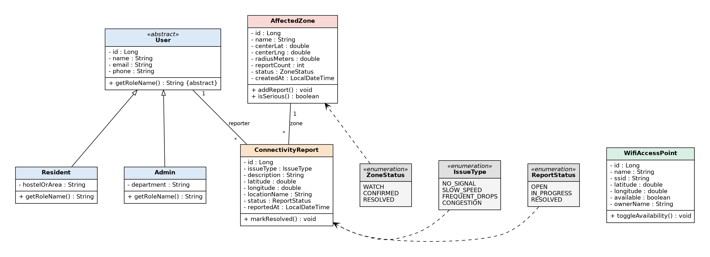
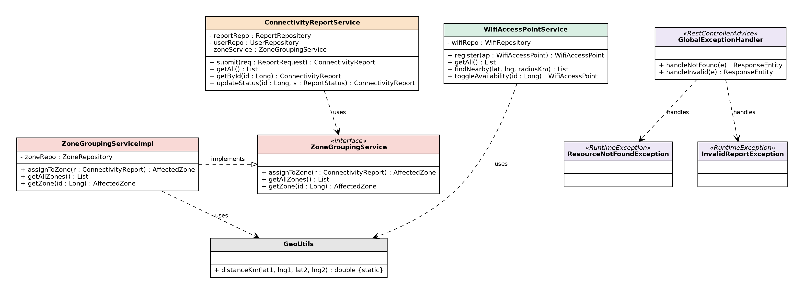

<div align="center">

# 📡 NetReach

### Community-Driven Internet Connectivity Assistance Platform

*Report it. Group it. Find a connection nearby.*


**Advanced OOP – Objective 4 | Group 14**

</div>

---

## 🌍 The Problem

Many students, residents and institutions, especially in hostels, residential areas and campuses, face poor or unavailable internet connectivity. Today each person complains separately to a provider. There is no shared place that shows **many people in the same area have the same problem**, or **where a working connection is available nearby**.

## 💡 The Solution

NetReach does not repair network infrastructure. It is a central system where:

1. 📝 Users **report** connectivity problems.
2. 🧩 The system **groups** nearby reports into an **affected zone**.
3. 📶 Registered community **Wi-Fi access points** near the zone are shown, so people know where they can connect.

---

## ✨ Features

| Module | What it does |
|---|---|
| 📝 **Connectivity Reporting** | Users submit a report (issue type, description, location). Reports are stored in the database and can be listed, viewed and updated (`OPEN`, `IN_PROGRESS`, `RESOLVED`). |
| 🧩 **Affected-Zone Grouping** | Each new report is automatically placed in an existing zone within **500 m**, or starts a new one. A zone with **3 or more reports** becomes `CONFIRMED`. |
| 📶 **Nearby Wi-Fi Access Points** | Admins register access points. The system lists the **available** ones nearest to a location or to an affected zone, sorted by distance. |

Also included: custom exception handling with clear error messages (`400` and `404`).

---

## 🖥️ Web Interface

NetReach comes with a simple web page built with **HTML, CSS and JavaScript** (no extra framework). Spring Boot serves it from `src/main/resources/static/index.html`, so it needs no separate setup. Once the app is running, open **http://localhost:8080**.

| Tab | What you can do |
|---|---|
| **Report a problem** | Register as a resident, then send a report. The page shows which zone the report joined and whether that zone is now confirmed. "Use my location" fills in your coordinates. |
| **Affected zones** | See every zone with a signal-bar icon (more bars = more reports) and its status. Tap **Find nearby Wi-Fi** on a zone to list available access points near it, with distances. |
| **Wi-Fi points** | Search for available access points near any location, add a new access point, and switch an access point on or off. |

The page talks to the same REST API listed below, so everything you do on it can also be done in Postman.

---

## 🔄 How the Modules Work Together



Distances are calculated with the **Haversine formula** (`GeoUtils`).

---

## 🧱 Architecture

```
Client (web page / Postman)
        │
        ▼
  Controller layer      ← REST endpoints
        │
        ▼
  Service layer         ← business logic, zone grouping
        │
        ▼
 Repository layer       ← Spring Data JPA
        │
        ▼
      MySQL
```

### OOP concepts used

| Concept | Where |
|---|---|
| **Inheritance** | `User` (abstract) → `Resident`, `Admin` |
| **Abstraction / Interface** | `ZoneGroupingService` with implementation `ZoneGroupingServiceImpl` |
| **Polymorphism** | `getRoleName()` overridden in each user type |
| **Encapsulation** | Private fields with getters and setters in all entities |
| **Association** | One user → many reports; one zone → many reports |
| **Exception handling** | `ResourceNotFoundException`, `InvalidReportException`, `GlobalExceptionHandler` |

---

## 🗂️ Project Structure

```
src/main/java/com/netreach
├── NetreachApplication.java
├── model         User, Resident, Admin, ConnectivityReport,
│                 AffectedZone, WifiAccessPoint, IssueType,
│                 ReportStatus, ZoneStatus
├── repository    UserRepository, ReportRepository,
│                 ZoneRepository, WifiRepository
├── service       ZoneGroupingService, ZoneGroupingServiceImpl,
│                 ConnectivityReportService, WifiAccessPointService
├── controller    UserController, ReportController,
│                 ZoneController, WifiController
├── dto           ReportRequest
├── exception     ResourceNotFoundException, InvalidReportException,
│                 GlobalExceptionHandler
└── util          GeoUtils

docs/diagrams                   architecture and class diagrams (PNG)
docs/postman                     Postman collection for the API

src/main/resources
├── static/index.html          web interface (HTML, CSS, JavaScript)
├── application.properties.example
└── application.properties     (your own copy, not in Git)
```

---

## 🚀 Getting Started

### Prerequisites
- Java 17 or later
- MySQL 8.x
- Spring Tool Suite (or any Maven-capable IDE)
- Postman (to try the API)

### Setup

1. **Clone the repository**
   ```bash
   git clone <repository-url>
   ```
2. **Create the database** in MySQL
   ```sql
   CREATE DATABASE netreach;
   ```
3. **Create your settings file.** Copy
   `src/main/resources/application.properties.example` to
   `src/main/resources/application.properties` and enter your MySQL password:
   ```properties
   spring.datasource.password=YOUR_MYSQL_PASSWORD
   ```
   > `application.properties` is listed in `.gitignore`, so your password is never uploaded.
4. **Import and run**
   - In Spring Tool Suite: **File → Import → Existing Maven Projects**, then right-click the project → **Run As → Spring Boot App**.
   - Or from a terminal in the project folder:
     ```bash
     mvnw.cmd spring-boot:run
     ```
5. The app starts on **http://localhost:8080**. Hibernate creates the tables automatically.
6. Open **http://localhost:8080** in your browser to use the web interface.

---

## 🔌 API Reference

### Users
| Method | Endpoint | Purpose |
|---|---|---|
| `POST` | `/api/users/residents` | Add a resident |
| `POST` | `/api/users/admins` | Add an admin |

### Connectivity reports
| Method | Endpoint | Purpose |
|---|---|---|
| `POST` | `/api/reports` | Submit a report (it is grouped into a zone automatically) |
| `GET` | `/api/reports` | List all reports |
| `GET` | `/api/reports/{id}` | Get one report |
| `PUT` | `/api/reports/{id}/status?value=RESOLVED` | Update status (`OPEN`, `IN_PROGRESS`, `RESOLVED`) |
| `GET` | `/api/reports/status/{value}` | List reports with one status (`OPEN`, `IN_PROGRESS`, `RESOLVED`) |

### Affected zones
| Method | Endpoint | Purpose |
|---|---|---|
| `GET` | `/api/zones` | List all zones |
| `GET` | `/api/zones/serious` | List confirmed (serious) zones |
| `GET` | `/api/zones/{id}/nearby-wifi?radiusKm=1` | Wi-Fi points near a zone |

### Wi-Fi access points
| Method | Endpoint | Purpose |
|---|---|---|
| `POST` | `/api/wifi` | Register an access point |
| `GET` | `/api/wifi` | List all access points |
| `GET` | `/api/wifi/{id}` | Get one access point |
| `GET` | `/api/wifi/nearby?lat=..&lng=..&radiusKm=1` | Available points near a location |
| `PUT` | `/api/wifi/{id}/toggle` | Switch availability on or off |

### Try it

**1. Add a resident** – `POST /api/users/residents`
```json
{ "name": "Anu", "email": "anu@mail.com", "phone": "9999999999", "hostelOrArea": "Hostel A" }
```

**2. Register a Wi-Fi point** – `POST /api/wifi`
```json
{ "name": "Library WiFi", "ssid": "LIB_NET", "latitude": 10.0275, "longitude": 76.3080, "available": true, "ownerName": "Library" }
```

**3. Submit a report** – `POST /api/reports` (send it three times)
```json
{ "userId": 1, "issueType": "NO_SIGNAL", "description": "No network in hostel",
  "latitude": 10.0270, "longitude": 76.3075, "locationName": "Hostel A" }
```
After the third report, `GET /api/zones` shows one zone with `reportCount` 3 and status `CONFIRMED`.

**4. Find Wi-Fi near the zone**
```
GET /api/zones/1/nearby-wifi?radiusKm=1
```
Returns *Library WiFi*.

Issue types: `NO_SIGNAL`, `SLOW_SPEED`, `FREQUENT_DROPS`, `CONGESTION`.

### Error responses
| Situation | Status | Message |
|---|---|---|
| Missing user, issue type or description | `400` | `userId, issueType and description are required` |
| Unknown user | `404` | `User not found: <id>` |
| Unknown zone | `404` | `Zone not found: <id>` |

---

## 🧪 Testing with Postman

A ready-made Postman collection is included: [`docs/postman/NetReach.postman_collection.json`](docs/postman/NetReach.postman_collection.json). It has every request in this README, plus the error cases.

**How to use it**
1. Start the application (it must be running on `http://localhost:8080`).
2. In Postman choose **Import** and select the collection file.
3. Open the **NetReach** collection and run the requests in order: add a resident, register a Wi-Fi point, submit three reports, then list the zones and ask for nearby Wi-Fi.

**If you make a request by hand:** for `POST` and `PUT` requests with data, open the **Body** tab, choose **raw**, set the type to **JSON**, and paste the body. `GET` requests and the toggle and status updates need no body.

| Step | Request | Expected result |
|---|---|---|
| 1 | `POST /api/users/residents` | `200`, a user with an `id` |
| 2 | `POST /api/wifi` | `200`, an access point with an `id` |
| 3 | `POST /api/reports` (three times) | `200`; the zone's `reportCount` goes 1, 2, 3 |
| 4 | `GET /api/zones` | One zone with status `CONFIRMED` |
| 5 | `GET /api/zones/1/nearby-wifi?radiusKm=1` | The available Wi-Fi points near the zone |
| 6 | `POST /api/reports` with an empty description | `400`, `userId, issueType and description are required` |
| 7 | `GET /api/zones/999/nearby-wifi` | `404`, `Zone not found: 999` |

---

## 🗄️ Database

| Table | Purpose |
|---|---|
| `app_user` | Residents and admins (single table with a `user_type` column) |
| `connectivity_report` | Reports, linked to a user (`user_id`) and a zone (`zone_id`) |
| `affected_zone` | Zones with centre, radius, report count and status |
| `wifi_access_point` | Registered Wi-Fi points and their availability |

---

## 📐 Diagrams

### Architecture


### Class diagrams




---

## 🌱 Sustainable Development Goals

| Goal | How NetReach supports it |
|---|---|
| **SDG 9** – Industry, Innovation and Infrastructure | Raises awareness and coordination around digital connectivity infrastructure |
| **SDG 10** – Reduced Inequalities | Helps people find alternatives when access is poor, reducing digital-access inequality |
| **SDG 11** – Sustainable Cities and Communities | Lets communities coordinate resources and respond together to infrastructure problems |

---

## 🔭 Future Scope

- Login and role-based access (admin, volunteer, access-point owner)
- Notifications to administrators and providers for serious or recurring zones
- Volunteers and access-point owners offering temporary connectivity
- Lowering a zone's count and marking it resolved when its reports are resolved
- A map view of affected zones

---

## 👥 Team – Group 14

| Name | Role |
|---|---|
| Kareena Treesa Thomas | Team Leader |
| Anjanapriya V P | Team Member |
| Athira Maria | Team Member |
| Parvathi B | Team Member |

---

<div align="center">

Made with ☕ for **Advanced OOP – Objective 4**

</div>
